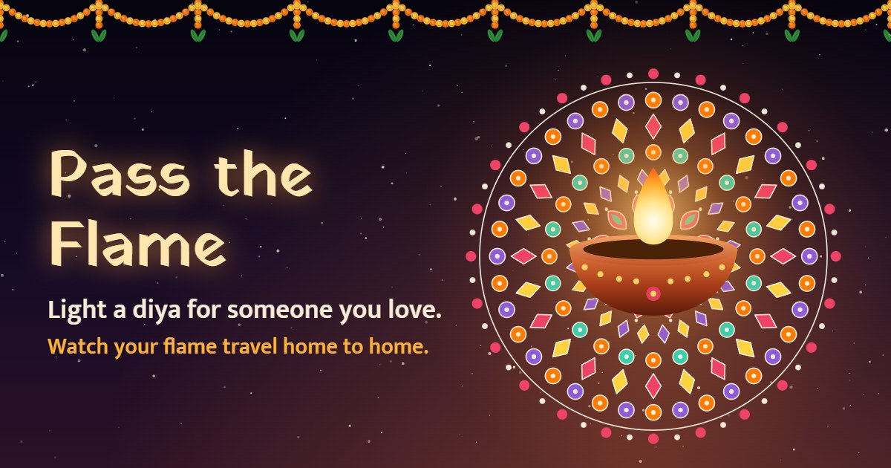

# Pass the Flame

A Diwali greeting that keeps travelling. Light a diya for someone you love. They open your link, your flame flies in and lights their diya, fireworks spell their name, and a rangoli made from that name blooms. Then they pass the flame to someone else, and every greeting remembers the chain it came from.

**Live:** https://pass-the-flame.web.app



<!-- Placeholder: replace the image above with a screen recording, such as docs/demo.gif. -->

## Features

- **Light a diya:** drag the matchstick to the wick, or tap to light it.
- **Receive the flame:** the sender's flame flies in, then fireworks spell the recipient's name in sparks.
- **A rangoli from your name:** the same name always grows the same pattern.
- **Fresh wishes:** Gemini writes each wish in English, Hindi or Bengali. If it fails or takes over 10 seconds, a handwritten wish takes over, so the app never breaks.
- **Respect for elders:** parents, grandparents, elder siblings, teachers and other elders are never shown by name.
- **Pass the flame:** each greeting remembers its chain, such as A → B → C.
- **Deepmala sky:** a live night sky of the latest diyas, with a total counter and flames passed.
- **Sharing:** a direct WhatsApp button, the native share sheet, copy link, and a wish card image for WhatsApp Status.
- **Sound:** a tanpura-like drone and bells in raag Bhupali, all synthesised, with a remembered on/off toggle.
- **Built for phones:** capped particles and pixel ratio, separately loaded pages, and full support for reduced motion.

## Tech

- React, Vite and Tailwind CSS
- Firebase Hosting and Cloud Firestore, on the free Spark plan with no Cloud Functions
- Firebase AI Logic with the Gemini Developer API (`gemini-3.5-flash-lite`), protected by App Check
- Canvas for the rangoli, fireworks and sky, and Web Audio for all sound

## Run locally

You need Node 20 or newer.

```bash
npm install
cp .env.example .env
npm run dev
```

Fill in `.env` from Firebase console > Project settings > Your apps. To try it on a phone on the same Wi-Fi, use `npm run dev:phone`.

The reCAPTCHA key does not allow `localhost`, so Gemini wishes only run on the deployed site. Locally you will see the handwritten wishes. Sharing and clipboard features also need HTTPS, so test those on the deployed site.

| Command          | What it does                             |
| ---------------- | ---------------------------------------- |
| `npm run dev`    | Start the dev server                     |
| `npm run build`  | Build for production into `dist/`        |
| `npm run lint`   | Run ESLint                               |
| `npm run format` | Format with Prettier                     |
| `npm run deploy` | Build, then deploy hosting and Firestore |

## Set up your own Firebase project

1. Create a project, and stay on the Spark plan.
2. Register a web app, and copy its config into `.env`.
3. Enable Firestore in production mode.
4. Create the document `stats/global` with the number field `totalDiyas` set to `0`. Every save fails without it.
5. Go to AI Services > AI Logic > Get started, and choose the Gemini Developer API.
6. Create a score-based Web key in the [reCAPTCHA console](https://console.cloud.google.com/security/recaptcha), without a checkbox challenge. Add your hosting domains, not `localhost`, and put the key in `.env` as `VITE_RECAPTCHA_SITE_KEY`.
7. In App Check > Apps, register the web app with that same key.
8. In App Check > APIs, enforce Firebase AI Logic only, with replay protection off. Do not enforce Firestore, because recipients load greetings without App Check.

## Deploy

```bash
npx firebase-tools login
npx firebase-tools use --add
npm run deploy
```

## How it is put together

```
src/
  pages/       CreatePage, ReceivePage, SkyPage
  components/  Diya, Matchstick, RangoliCanvas, FireworksCanvas, ChainGarland,
               MessageCard, SharePanel, SoundToggle, DiyaRow, DeepmalaCanvas, ...
  hooks/       useCelebration, useGreetingCreation
  lib/         firebase, gemini, greetings, sky, rangoli, fireworks, deepmala,
               audio, wishes, wishCard, profanity, sanitize, ...
demo/          The original single-file prototype
```

### Data

| Path             | Who can read       | Contents                                                                                         |
| ---------------- | ------------------ | ------------------------------------------------------------------------------------------------ |
| `greetings/{id}` | Anyone with the id | `from`, `to`, `relation`, `lang`, `message`, `parentId`, `rootId`, `chain`, `depth`, `createdAt` |
| `sky/{id}`       | Latest 100 only    | `passed`, `createdAt`                                                                            |
| `stats/global`   | Anyone             | `totalDiyas`, `flamesPassed`                                                                     |

`sky` is separate on purpose. Firestore rules cannot hide individual fields, so letting the sky list `greetings` would expose every name, message and private link. A sky record holds none of those.

### Security rules

`firestore.rules` makes greetings create-only, with strict checks on types, lengths and allowed values, and checks each passed flame against its parent. Counters can only rise by one. Everything else is denied.

The profanity filter runs on the client, so it can be bypassed by calling the API directly. So can the counters, by adding one at a time.

## Limits

- **Gemini's free tier:** some replies are slow, so a second request races the first after 2.5 seconds. Some greetings will still get a handwritten wish.
- **Spark quotas:** 50K Firestore reads a day and 360 MB of hosting transfer a day. This is why the sky shows the latest 100 diyas rather than all of them.
- **Very long chains:** past 8 names, a chain keeps the person who began it plus the latest 7.

Built with Firebase & Gemini for Diwali Digital Diya 2026.
